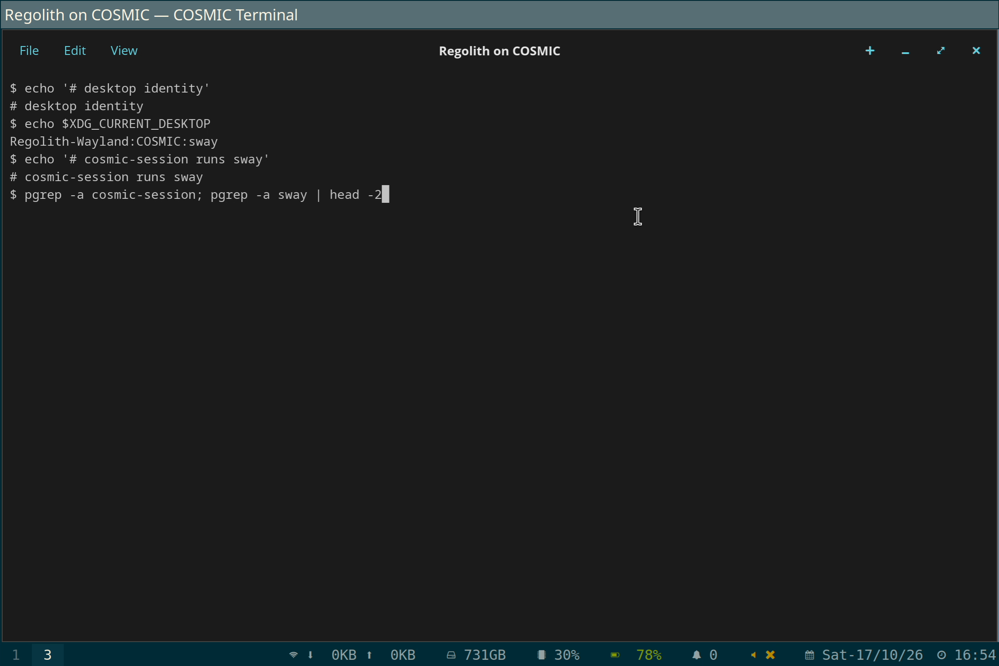

# Build a COSMIC-based Wayland session for Regolith

This repository is the public evidence bundle for the GSoC 2026 project
**Build a COSMIC-based Wayland Session for Regolith**.

The work adapts Regolith's existing session components for COSMIC while
keeping the GNOME path available. The preferred design is shared interfaces
and separate backends, not a second set of replacement daemons.

## Current result

**Status: 9 of 12 proposal criteria met** (1, 2, 4, 5, 6, 8, 9, 11, 12).
Partial: 7 (scale persists, but refresh rate cannot be tested on a panel that
only offers 59.999 Hz) and 10 (packages are unsigned and need a signing and
publication decision). Not met: 3 (needs multi-display hardware).

Proof for 4, 6, 8 and 12 comes from a physical Pop!_OS laptop with the
packages installed. Proof for 1, 2, 5, 9 and 11 is mostly from QEMU, also
seen on the laptop session. There was no fresh login after the final
install, apart from a check that the settings daemon autostarted.

**Demo video (112 s, physical laptop):**
[](https://github.com/Rahul-2k4/regolith-cosmic-gsoc-proof/releases/download/gsoc-final-2026-10-17/regolith-on-cosmic-demo.mp4)

To install, rebuild or check the packages, follow [REPRODUCE.md](REPRODUCE.md).
The release is `gsoc-final-2026-10-17`.

## Architecture

```text
Greeter
  -> regolith-session-cosmic
  -> cosmic-session
  -> compositor/session helpers
  -> regolith-cosmic.target
       -> regolith-init-inputd.service
       -> regolith-init-displayd.service
```

The GNOME session remains a separate path. `regolith-inputd` uses feature
gates for GNOME and COSMIC implementations, then selects the runtime backend
from `XDG_CURRENT_DESKTOP`. Display handling follows the existing
`regolith-displayd` boundary and Wayland output-management observer rather
than introducing an unrelated persistence daemon.

## What is working

- Login into the COSMIC-backed session through the Regolith wrapper, with
  separate COSMIC and GNOME targets.
- `regolith-inputd` COSMIC backend, including keyboard layout and variant set
  as a pair.
- Regolith key bindings winning over colliding COSMIC shortcuts.
- Lock/unlock and OSDs, and the retained Sway workspace and launcher keys.
- Vendored offline builds, and Voulage pins for every package.

## What is not proven

- Multi-display, hotplug and mixed-DPI behaviour (criterion 3).
- Refresh-rate persistence, which needs a panel with more than one rate.
- Package signing and archive publication (criterion 10).
- A fresh login after the final package install.

These are proof boundaries, not claims that the missing behaviour is already
implemented. Older QEMU-only notes in this repository are dated history.

## Reproduce the verified work

Start with [REPRODUCE.md](REPRODUCE.md). For history, see the [final handoff](FINAL_HANDOFF.md) and use the current
[work product](WORK_PRODUCT.md) for the evidence map. The exact installer
order and safety checks are in [docs/INSTALL.md](docs/INSTALL.md).

Useful entry points:

- [Repository and branch status](docs/REPOSITORY_STATUS.md)
- [Gist update draft](docs/GIST_UPDATE_DRAFT.md)
- [Architecture reference](ARCHITECTURE.md)
- [QEMU display proof script](scripts/reproduce-qemu-display-proof.sh)
- [Inputd session verifier](scripts/verify-qemu-inputd-session-contract.sh)
- [Voulage reproduction script](scripts/reproduce-voulage-branch-tuple.sh)

The scripts are evidence helpers. They do not replace a real hardware test.
Read each script's prerequisites before running it.

## Source branches

The final code is on `Rahul-2k4` fork branches (see the table in
[REPRODUCE.md](REPRODUCE.md)). Upstream sandptel/cosmolith PR #15 is merged;
#17, #18 and #19 are open. The current branch and PR
inventory, including local-only candidates, is maintained in
[docs/REPOSITORY_STATUS.md](docs/REPOSITORY_STATUS.md).

## Submission

The final work product is the submitted
[GSoC write-up](https://gist.github.com/Rahul-2k4/ace071f9dc818ae31d72ff1f0fa27f49).
This repository supplies the code references, scripts, package identities,
logs, screenshots, and limitations behind that write-up.
